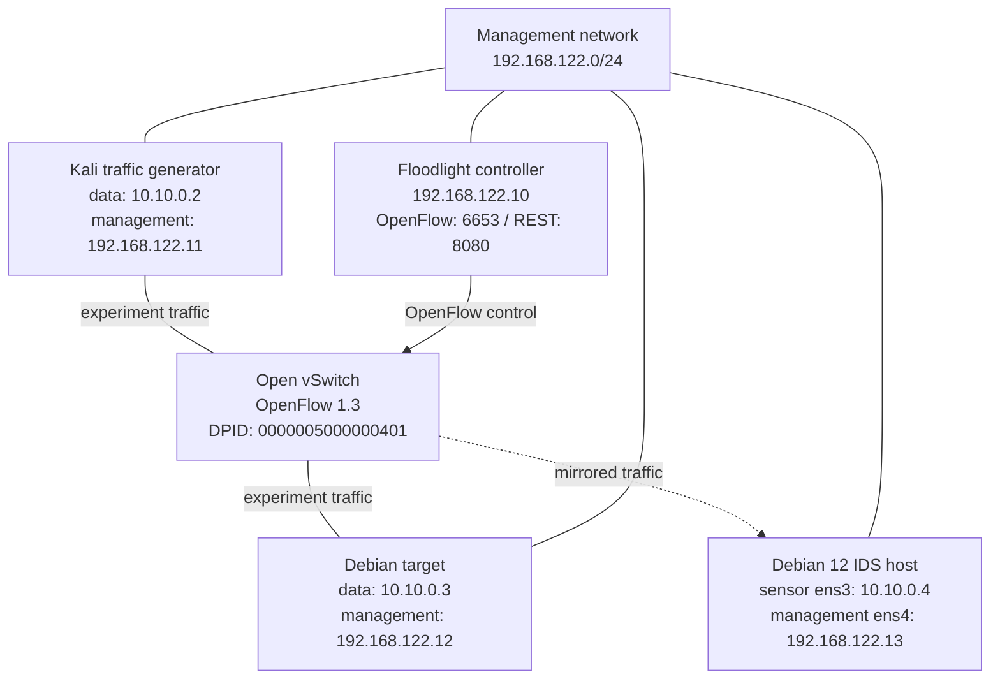
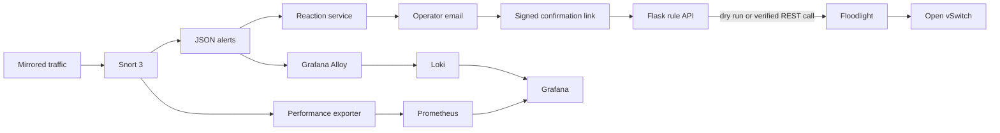

# Laboratory architecture

## Network topology

The IDS interface must receive an actual mirrored copy from the switch. Promiscuous mode alone does not make traffic between Kali and Debian visible.

## Application flow

The Flask API also validates Snort rules through the local Snort agent before replacing the active ruleset and requesting a reload. Reaction state is stored in SQLite on the IDS host.

## Trust and safety boundaries

- The data network is an isolated experiment network. Do not bridge it directly to a production network.
- The management network carries the Floodlight REST calls, dashboards, confirmation links, and administrative traffic.
- `REACT_DRY_RUN=true` prevents the application from opening the Floodlight connection while still exercising rule construction.
- The controller-facing interface must not be added as an OVS data port.
- The repository contains no passwords, tokens, private keys, or full VM disks.
